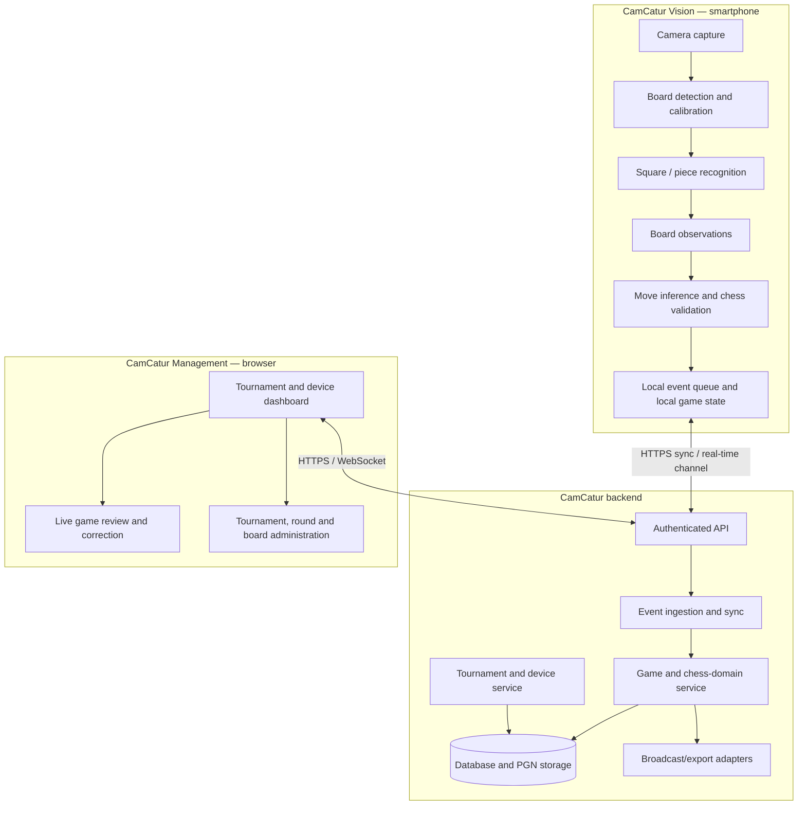

# CamCatur System Architecture

**Status:** Initial logical architecture  
**Date:** 10 November 2026

## 1. Overview

CamCatur consists of three principal runtime areas:

1. **CamCatur Vision:** mobile capture and recognition.
2. **CamCatur backend:** authenticated APIs, game/event services, persistence and integrations.
3. **CamCatur Management:** browser-based tournament and device operations.

The backend may initially be deployed on one server. Logical separation is required; microservices are not required for the MVP.

## 2. Logical architecture



## 3. Mobile application modules

### 3.1 Camera capture
Responsibilities:
- Request and manage camera permissions.
- Select rear camera and supported resolution/frame rate.
- Control focus, exposure and white balance where supported.
- Detect camera interruptions and lifecycle changes.
- Avoid unnecessary frame processing; use sampling appropriate to the recognition pipeline.
- Monitor battery, temperature and storage constraints.

### 3.2 Board detection and calibration
Responsibilities:
- Guide the user to position the phone.
- Detect board corners and orientation.
- Map the physical board to 8×8 logical squares.
- Support manual corner adjustment.
- Store calibration with device/camera and board metadata.
- Detect when the board moves and request recalibration.

### 3.3 Recognition pipeline
Responsibilities:
- Extract board/square regions.
- Classify square occupancy and piece identity/colour.
- Produce a board observation with confidence and timestamp.
- Track uncertainty, occlusion and lighting changes.
- Permit model/runtime replacement.

The pipeline should distinguish:
- Empty square.
- White/black piece class.
- Unknown/occluded square.
- Low-confidence observation.

### 3.4 Move inference and chess validation
Responsibilities:
- Compare observations over time.
- Infer candidate moves, including multi-square changes.
- Validate candidates against the current legal position.
- Handle captures, castling, en passant and promotion.
- Distinguish temporary hand occlusion from a completed move.
- Request operator confirmation when the result is ambiguous.
- Maintain FEN and PGN only from accepted game-state transitions.

### 3.5 Local persistence and sync
Responsibilities:
- Persist the active session and event queue.
- Assign event UUIDs and monotonic per-device sequence numbers.
- Retry safely after network recovery.
- Track acknowledgement and sync state.
- Retain enough local data to recover after app restart.
- Surface storage pressure and sync errors.

## 4. Backend modules

Start as a modular application with clear internal boundaries:

- **Identity and access:** users, roles, sessions and authentication.
- **Device registry:** device identity, pairing, status, software version and capabilities.
- **Tournament service:** tournaments, sections, rounds, players and boards.
- **Assignment service:** device-to-board/game-session mapping.
- **Game service:** current position, move history, FEN and PGN.
- **Event ingestion:** idempotent event acceptance, ordering and acknowledgement.
- **Review/correction:** accepted, rejected and corrected observations.
- **Broadcast/export adapters:** external broadcast providers, PGN download and other integrations.
- **Audit log:** important operator actions and game corrections.

## 5. Web management modules

- Tournament overview.
- Round and board administration.
- Device registration and pairing.
- Device health dashboard.
- Live board/game monitor.
- Recognition exception queue.
- Game correction and manual move entry.
- PGN/FEN viewer and export.
- User and operator permissions.
- Broadcast configuration and status.

The web interface must work without installing a native desktop application.

## 6. Communication contracts

### 6.1 Device identity

Each mobile installation receives a server-recognised device identity after a secure pairing process. Do not use a hard-coded shared secret across all phones.

Suggested device metadata:
- `device_id`
- `display_name`
- `platform`
- `app_version`
- `model`
- `camera_capabilities`
- `last_seen_at`
- `battery_level` (when available and permitted)
- `storage_status`
- `connection_status`
- `paired_at`

### 6.2 Game event envelope

Initial conceptual event shape:

```json
{
  "event_id": "uuid",
  "device_id": "device-uuid",
  "game_session_id": "game-uuid",
  "sequence": 42,
  "event_type": "candidate_move",
  "captured_at": "2026-11-10T03:00:00Z",
  "schema_version": 1,
  "payload": {
    "from": "e2",
    "to": "e4",
    "uci": "e2e4",
    "confidence": 0.97,
    "fen_before": "...",
    "fen_after": "..."
  }
}
```

This is illustrative, not a final API contract. The production schema must distinguish observation events, candidate moves, confirmed moves, corrections and sync acknowledgements.

### 6.3 Delivery semantics

- At-least-once delivery is acceptable if the server is idempotent.
- `event_id` prevents duplicate application.
- `sequence` helps detect missing or out-of-order events.
- Server acknowledgements identify accepted, duplicate, rejected or conflicting events.
- Corrections are auditable and must not erase the original event history.

## 7. Data model — initial entities

- `users`
- `roles`
- `devices`
- `device_pairings`
- `tournaments`
- `sections`
- `rounds`
- `players`
- `boards`
- `game_sessions`
- `device_assignments`
- `game_events`
- `game_positions`
- `game_moves`
- `game_corrections`
- `broadcast_destinations`
- `sync_batches`
- `audit_logs`

A detailed relational schema should be produced after workflows and event semantics are validated.

## 8. Deployment modes

### Local venue mode
- Backend hosted on a venue LAN server or suitable local machine.
- Phones and operator browsers connect over local Wi-Fi.
- Internet may be unavailable.
- External broadcasting is queued until connectivity is available.

### Hosted mode
- Backend hosted on a remote server.
- Phones and operator browsers connect over the internet.
- Authentication, TLS, monitoring, backup and rate limiting are required.

### Hybrid mode
- Local capture and buffering continue during internet outages.
- Local backend or phone queues synchronise with hosted services when connectivity returns.
- Conflict resolution and authority rules must be explicit before this mode is production-ready.

## 9. Security and privacy

- Pair devices using short-lived pairing codes or another secure mechanism.
- Use TLS for network communication.
- Revoke lost or retired devices.
- Scope device credentials to the minimum required operations.
- Authenticate operators and enforce roles.
- Keep audit records for game corrections and administrative changes.
- Define retention policies for images, diagnostic frames and game records.
- Do not stream or retain continuous video by default unless an explicit product requirement justifies it.
